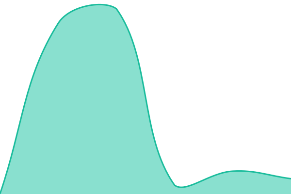

# [📈 Live Status](https://status.airest.ai): <!--live status--> **🟩 All systems operational**

This repository contains the open-source uptime monitor and status page for [airestinc-a11y](https://status.airest.ai), powered by [Upptime](https://github.com/upptime/upptime).

With [Upptime](https://upptime.js.org), you can get your own unlimited and free uptime monitor and status page, powered entirely by a GitHub repository. We use [Issues](https://github.com/airestinc-a11y/status/issues) as incident reports, [Actions](https://github.com/airestinc-a11y/status/actions) as uptime monitors, and [Pages](https://status.airest.ai) for the status page.

<!--start: status pages-->
<!-- This summary is generated by Upptime (https://github.com/upptime/upptime) -->
<!-- Do not edit this manually, your changes will be overwritten -->
<!-- prettier-ignore -->
| URL | Status | History | Response Time | Uptime |
| --- | ------ | ------- | ------------- | ------ |
|  [Website](https://airest.ai) | 🟩 Up | [website.yml](https://github.com/airestinc-a11y/status/commits/HEAD/history/website.yml) | 

 881ms
     
 | 

<a href="https://status.airest.ai/history/website">100.00%</a>
    

|  [App](https://app.airest.ai/login) | 🟩 Up | [app.yml](https://github.com/airestinc-a11y/status/commits/HEAD/history/app.yml) | 

 942ms
     
 | 

<a href="https://status.airest.ai/history/app">100.00%</a>
    

|  [Messaging engine](https://app.airest.ai/api/health) | 🟩 Up | [messaging-engine.yml](https://github.com/airestinc-a11y/status/commits/HEAD/history/messaging-engine.yml) | 

 773ms
     
 | 

<a href="https://status.airest.ai/history/messaging-engine">100.00%</a>
    

|  [WhatsApp message receiver](https://inbox.airest.ai/webhooks/whatsapp/status-check) | 🟩 Up | [whatsapp.yml](https://github.com/airestinc-a11y/status/commits/HEAD/history/whatsapp.yml) | 

 833ms
     
 | 

<a href="https://status.airest.ai/history/whatsapp">100.00%</a>
    

|  [Instagram message receiver](https://inbox.airest.ai/webhooks/instagram) | 🟩 Up | [instagram.yml](https://github.com/airestinc-a11y/status/commits/HEAD/history/instagram.yml) | 

 826ms
     
 | 

<a href="https://status.airest.ai/history/instagram">100.00%</a>
    

|  [Messenger message receiver](https://inbox.airest.ai/bot) | 🟩 Up | [messenger.yml](https://github.com/airestinc-a11y/status/commits/HEAD/history/messenger.yml) | 

 756ms
     
 | 

<a href="https://status.airest.ai/history/messenger">100.00%</a>
    

|  [Website chat script](https://inbox.airest.ai/packs/js/sdk.js) | 🟩 Up | [website-chat.yml](https://github.com/airestinc-a11y/status/commits/HEAD/history/website-chat.yml) | 

 168ms
     
 | 

<a href="https://status.airest.ai/history/website-chat">100.00%</a>
    

<!--end: status pages-->

[**Visit our status website →**](https://status.airest.ai)

## 📄 License

- Powered by: [Upptime](https://github.com/upptime/upptime)
- Code: [MIT](./LICENSE) © [Anand Chowdhary](https://anandchowdhary.com)
- Data in the `./history` directory: [Open Database License](https://opendatacommons.org/licenses/odbl/1-0/)
